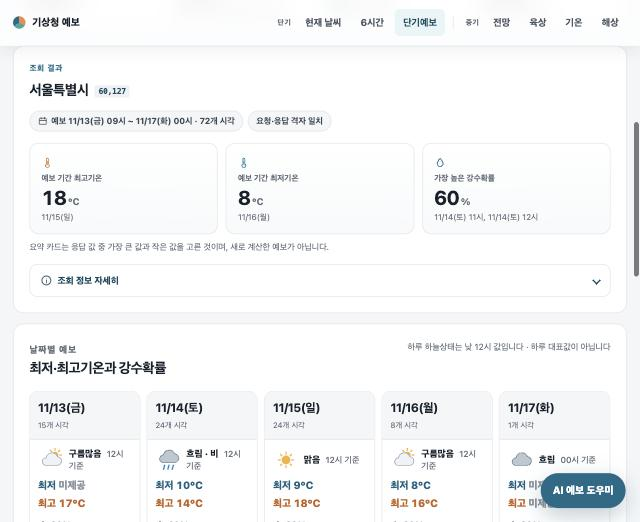
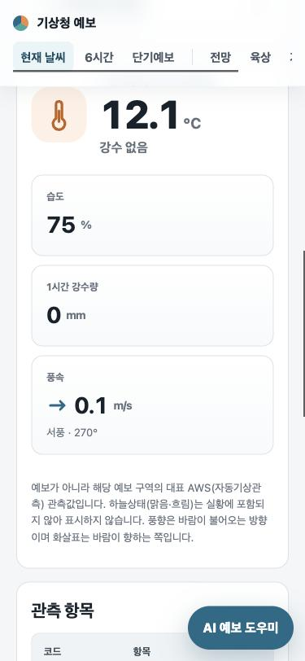
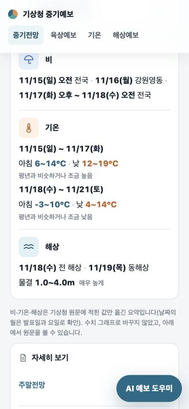

# 기상청 예보 조회 웹사이트 (단기 + 중기)

기상청 공공데이터 API로 **지금 날씨부터 10일 뒤 전망까지** 한 사이트에서 카드·그래프·표로 보여 주는 웹사이트입니다. 전국 3,838개 지역을 고를 수 있고, 별도 패키지 없이 Python만으로 실행됩니다.

> **비공식 학습 프로젝트입니다.** 기상청 공공데이터를 이용해 만든 개인 프로젝트이며 기상청의 공식 서비스가 아닙니다. 정확한 예보는 기상청 공식 채널에서 확인하세요.

**▶ [스냅샷 데모 바로 보기](https://claude.ai/artifact/KpEE7LPH1e1kCYgMMQugo6)** — 설치 없이 브라우저에서 둘러볼 수 있습니다. 실제 기상청 응답을 한 번 받아 둔 정적 페이지라 실시간으로 바뀌지 않고, 서울 등 대표 지역만 들어 있습니다.



<p>
  
  
</p>

## 주요 기능

- **7개 예보 페이지** — 현재 날씨, 6시간 예보, 단기예보(며칠 앞까지 시간별), 중기 전망·육상·기온·해상(최대 10일)
- **전국 3,838개 지역** — 시도·시군구·읍면동 검색, 단기 페이지끼리는 선택한 지역을 공유
- **읽기 쉬운 요약** — 기간 중 최고·최저값 카드, 날씨 아이콘 타임라인, 강수확률·기온·파고 그래프
- **중기전망 3줄 요약** — 긴 전망 원문에서 비·기온·해상 정보를 원문 그대로 뽑아 맨 위에 요약
- **자동 갱신** — 열어 둔 탭이 30초마다 새 발표본을 확인하되, 기상청 일일 호출 한도를 넘지 않게 서버가 조절
- **모바일·접근성** — 모바일 바텀시트 선택창, 키보드·스크린리더 지원, '동작 줄이기' 설정 시 애니메이션 끔
- **AI 예보 도우미 (선택)** — Gemini 키를 넣으면 "부산 해상예보 보여 줘" 같은 한국어 요청으로 페이지 이동·지역 선택·예보 설명

| 구분 | 페이지 | 주소 | 기상청 API |
|---|---|---|---|
| 단기 | 현재 날씨 (첫 화면) | `/now` | `getUltraSrtNcst` 초단기실황 |
| 단기 | 6시간 예보 | `/ultra` | `getUltraSrtFcst` 초단기예보 |
| 단기 | 단기예보 | `/short` | `getVilageFcst` 단기예보 |
| 중기 | 중기전망 | `/outlook` | `getMidFcst` |
| 중기 | 중기육상예보 | `/land` | `getMidLandFcst` |
| 중기 | 중기기온 | `/temperature` | `getMidTa` |
| 중기 | 중기해상예보 | `/sea` | `getMidSeaFcst` |

## 빠른 시작

1. **인증키 발급** — 공공데이터포털에서 [기상청_중기예보 조회서비스](https://www.data.go.kr/data/15059468/openapi.do)와 기상청_단기예보 조회서비스를 활용신청하고 일반 인증키(Decoding)를 받습니다.
2. **키 저장** — `KEY.env.example`을 복사해 `KEY.env`로 이름을 바꾸고 키를 넣습니다. 이 파일은 저장소에 올라가지 않습니다.
   ```text
   KMA_SERVICE_KEY=발급받은_실제_인증키
   ```
3. **실행** — Python 3.10 이상이 필요합니다. Windows는 `서버실행.cmd`를 더블클릭하고, macOS·Linux는 다음을 실행합니다.
   ```bash
   python3 server.py
   ```
4. 브라우저에서 <http://127.0.0.1:8080/> 에 접속합니다.

Windows에서 `KEY.env.txt`가 되는 문제, 포트 충돌, 오류 메시지별 해결 방법은 [설치·실행 가이드](docs/setup.md)에 있습니다.

## 기술 구성

- **서버:** Python 표준 라이브러리만 사용(`http.server`, `urllib`, `sqlite3`). 브라우저는 기상청에 직접 요청하지 않고 로컬 서버를 거칩니다.
- **화면:** 프레임워크 없는 HTML·CSS·JavaScript. 그래프도 직접 그립니다.
- **호출 관리:** SQLite에 모든 외부 호출을 기록하고, 캐시·호출 간격·일일 상한으로 기상청 한도(일 10,000회)를 지킵니다.
- **테스트:** 실제 API 응답을 고정한 fixture로 Python `unittest` 65개 + Node 테스트.

```text
server.py            기상청 API 게이트웨이·웹 서버 (캐시, 호출량 관리, AI 도우미)
shortterm.py         단기예보 기능(발표시각 계산, 코드값 해석)
static/              화면 (app.js, short.js, combo.js, outlook-parse.js, styles.css …)
data/                지역 코드 목록 (격자 3,838곳, 기온 지점 203곳)
tests/               단위 테스트와 실제 응답 fixture
tools/               지역 목록 변환, 스냅샷 데모 생성 스크립트
```

## 만들면서 신경 쓴 점

- **API 한도 보호** — 탭을 여러 개 열어도 외부 호출은 하루 최대 약 2,880회. 9,000회 상한, 8,000회부터 경고, 제공기관 제한 시 캐시만 표시.
- **인증키 비노출** — 키는 서버에서만 쓰며 브라우저 코드·화면·로그·오류 메시지·캐시에 남기지 않습니다.
- **데이터를 바꾸지 않기** — 없는 값은 0이 아니라 '미제공'으로, 전망 요약은 원문에 적힌 값만 옮깁니다. 가이드 문서와 실제 응답이 다른 부분은 실제 응답으로 확인해 기록했습니다.

## 문서

| 문서 | 내용 |
|---|---|
| [설치·실행 가이드](docs/setup.md) | 인증키 설정 상세, 실행 방법, 오류별 해결 |
| [자동 갱신·호출량 관리](docs/operations.md) | 캐시·호출 간격·일일 상한, 여러 서버 구성, Gemini 도우미 설정 |
| [데이터 해석 노트](docs/data-notes.md) | 응답 필드 해석, 단기예보 코드값, 문서와 실제 응답의 차이 |
| [화면 구성과 표시 규칙](docs/ui.md) | 페이지별 화면, 드롭다운, 날짜 표기, 중기전망 요약 규칙 |
| [개발·테스트](docs/development.md) | 테스트 실행, 스냅샷 데모 만들기, 보조 스크립트 |
| [검증 결과](VERIFICATION.md) | 실제 API·브라우저로 확인한 항목과 스크린샷 |

## 데이터 출처

- 기상청 중기예보 조회서비스(`MidFcstInfoService`), 단기예보 조회서비스(`VilageFcstInfoService_2.0`) — [공공데이터포털](https://www.data.go.kr)
- 지역 코드: 기상청 제공 예보구역 Excel, 단기예보 격자 위경도 Excel
